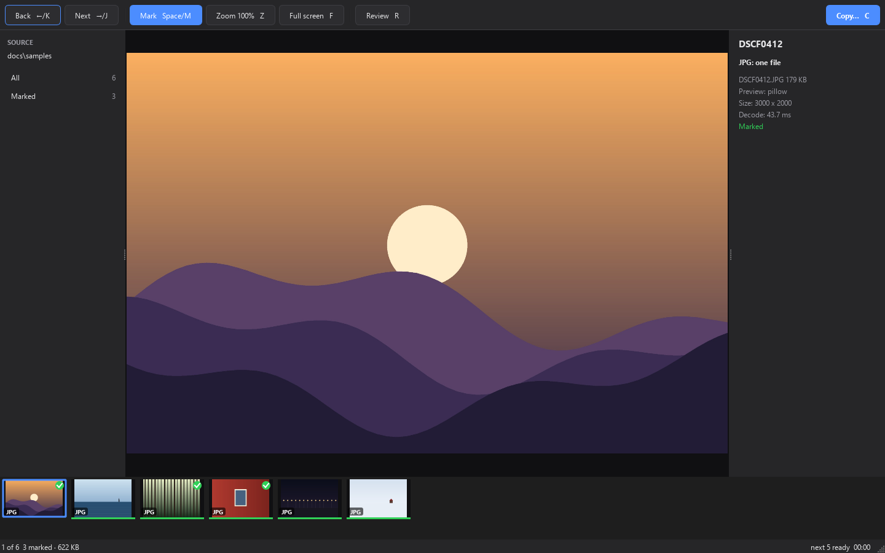
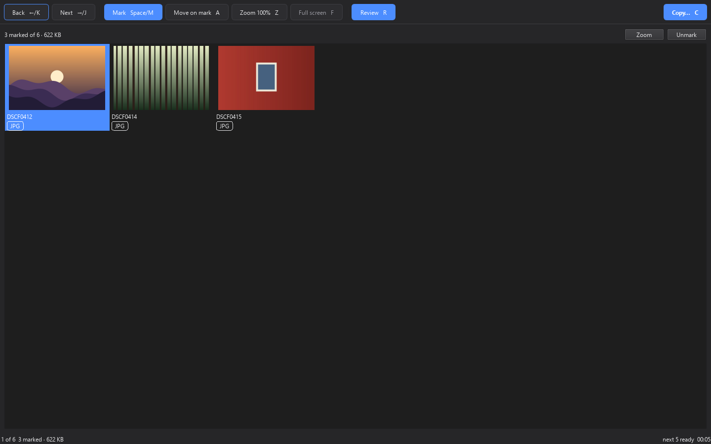
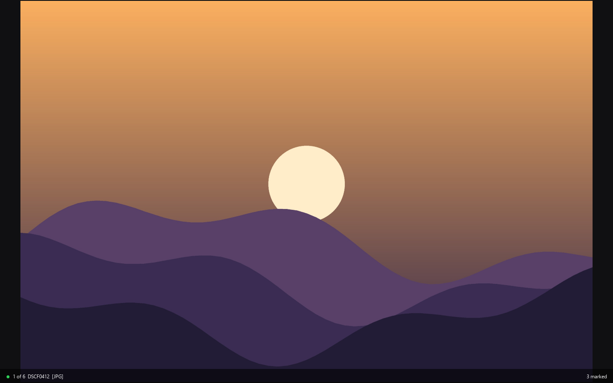

<pre align="center">
   _____ ____  __  _______   ___
  / ___// __ \/ / / /__  /  /   |
  \__ \/ /_/ / / / /  / /  / /| |
 ___/ / ____/ /_/ /  / /__/ ___ |
/____/_/    \____/  /____/_/  |_|
</pre>

<p align="center">
  
</p>

<h1 align="center">Spuza</h1>

<p align="center">
  Fast photo culling for camera cards.<br>
  Card in, first picture on screen in under a second, one key per decision.
</p>

<p align="center">
  <a href="https://github.com/fungimasters/Spuza/actions/workflows/ci.yml"></a>
  <a href="https://github.com/fungimasters/Spuza/releases/latest"></a>
  
  
  <a href="LICENSE"></a>
</p>

---

## What it does

Spuza is for the first pass over a shoot: hundreds of frames, a handful of keepers.
It opens the card, shows the first picture at once, and gets out of the way.

- **Step** through the card with one key. The next pictures are already decoded, so a step takes about 10 ms.
- **Mark** a keeper, keep going. Go back and mark later; nothing is lost.
- **Marks live in Spuza, not in your files.** Nothing is ever written to a picture, its EXIF or the card; the only thing Spuza writes is the copy you ask for, into the folder you pick.
- **Move on mark**, if you like: with `A` on, marking a picture shows the next one, so a pass over the card is one key per frame.
- **Review** every marked picture on one contact sheet. Unmark what did not survive a second look.
- **Zoom** to 100% for the sharpness check. On a raw file this triggers a full decode in the background.
- **Copy** the keepers to a folder on your drive. A raw file travels with its JPEG twin.

Nothing on the card is ever modified or deleted.

## Install

### macOS (Apple Silicon, macOS 14 or newer)

Two lines in Terminal. The first installs [uv](https://docs.astral.sh/uv/), the Python tool manager; the second installs Spuza.

```sh
curl -LsSf https://astral.sh/uv/install.sh | sh
```

Open a **new** Terminal window, then:

```sh
uv tool install --python 3.13 git+https://github.com/fungimasters/Spuza
```

That is all. Put a card in and run:

```sh
spuza
```

| | |
|---|---|
| Update | `uv tool upgrade spuza` |
| Remove | `uv tool uninstall spuza` |
| Open a folder instead of a card | `spuza ~/Pictures/trip` |

> **Why uv and not an installer?** Spuza is a Python application. `uv tool install` gives it its own private Python and dependencies, puts one `spuza` command on your PATH, and upgrades or removes it cleanly. No system Python is touched and nothing needs admin rights.

### macOS app bundle

Every [release](https://github.com/fungimasters/Spuza/releases/latest) also carries `Spuza-macos.zip`, a self-contained `Spuza.app` built by CI on a macOS runner.
Unzip it and drag `Spuza.app` to Applications.

The bundle is not code-signed, so macOS refuses the first launch. Open **System Settings > Privacy & Security**, scroll to the message about Spuza and click **Open Anyway**. This is needed once. The Terminal alternative is:

```sh
xattr -dr com.apple.quarantine /Applications/Spuza.app
```

### Windows

```powershell
uv tool install --python 3.13 git+https://github.com/fungimasters/Spuza
spuza
```

Spuza scans removable drives for a `DCIM` folder, or takes a folder on the command line.

## Using Spuza

<p align="center">
  
</p>

| Key | Does |
|---|---|
| `Space` or `M` | mark / unmark the picture |
| `A` | move on mark: on or off (marking then shows the next picture; remembered between runs) |
| `→` or `J` | next picture |
| `←` or `K` | previous picture |
| `Z` | 100% zoom (full decode of a raw file runs in the background) |
| `F` | full-screen, picture only (`Esc` returns) |
| `R` | review the marked pictures on a contact sheet |
| `C` | copy the marked pictures to a folder |
| `Cmd-,` (`Ctrl-,` on Windows) | preferences: how many pictures are decoded ahead and kept behind |

Every key is also a button in the toolbar, with its shortcut printed on it.
The sidebar shows the source and the counts; the inspector shows the file, its size and how long it took to decode.

<p align="center">
  
</p>

### Formats

| Family | Files | Shown as |
|---|---|---|
| Raw | Fujifilm `RAF`, `DNG` (cameras and phones) | the full-size JPEG preview embedded in the raw |
| JPEG | `JPG`, `JPEG` | as is |
| Other | `PNG`, `GIF`, `BMP`, `TIFF`, `HEIC` | as is |

A raw file and a JPEG with the same name (`DSCF0412.RAF` and `DSCF0412.JPG`) are **one picture**: one entry in the filmstrip, one mark, and both files are copied together.

### Copying

`C` opens the copy sheet: pick a destination folder, see the plan (how many files, how many bytes, what is already there), and go.
Files that already exist with identical content are skipped, not overwritten.

### Classic and advanced mode

Spuza opens in classic mode, which is everything it has shipped. Advanced mode adds features still being tried out: tick "Advanced mode" in Preferences (saved, applies from the next launch), or run `spuza --advanced` (or `spuza --classic`) for one run only; the saved preference is not touched. Advanced mode shows `(advanced)` in the window title and an `ADVANCED` tag in the status strip. See [docs/FEATURE_FLAGS.md](docs/FEATURE_FLAGS.md).

## How it stays fast

- **No demosaicing on the way through.** A raw file carries a camera-made JPEG preview. Spuza slices it straight out of the file (RAF header offsets, DNG SubIFDs) in a few milliseconds and shows that. The expensive full decode runs only when you press `Z`, and only if the preview is smaller than the sensor.
- **Prefetch.** The pictures ahead of and behind the current one are decoded in a thread pool, so a step is a texture swap. The default window is 12 ahead and 8 behind (about 21 pictures); at 2560 px each picture is about 13 MB, so that is about 275 MB of previews; the process as a whole sits around 1.7x that on macOS and Linux (their allocators keep freed decode buffers), less on Windows. Change it in Preferences, or with `--ahead N --behind N` for one run.
- **Measured.** `spuza --demo <folder> --bench` prints the first-paint time, every step, and every full decode. On a six-file test set (five Ricoh GR DNGs of 29 MB, one Fujifilm X-Pro2 RAF) the step mean is about 10 ms and the first picture is on screen in under a second.

## Development

```sh
git clone https://github.com/fungimasters/Spuza
cd Spuza
uv sync
uv run spuza --demo docs/samples
```

The project gate, run from the repository root:

```sh
uv run --project . ruff check --select F src tests && uv run --project . python -m pytest -q
```

CI runs the gate on Linux, Windows and macOS 15 and builds the unsigned `Spuza.app`.
Pushing a tag `vX.Y.Z` publishes a GitHub release with the wheel and the app bundle.
The screenshots in this README come from `docs/screenshots.py`, which drives the real window headless over `docs/samples`.

Built with [PySide6](https://doc.qt.io/qtforpython-6/), [rawpy](https://github.com/letmaik/rawpy), [Pillow](https://python-pillow.org/) and [pillow-heif](https://github.com/bigcat88/pillow_heif). Python 3.12 or newer.

## License

[MIT](LICENSE)
