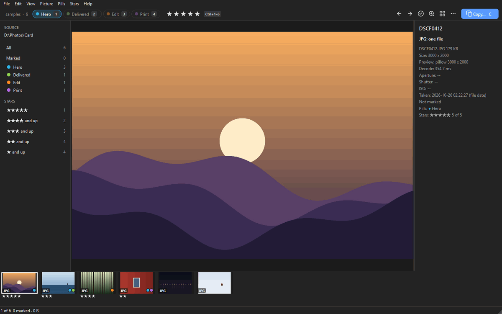
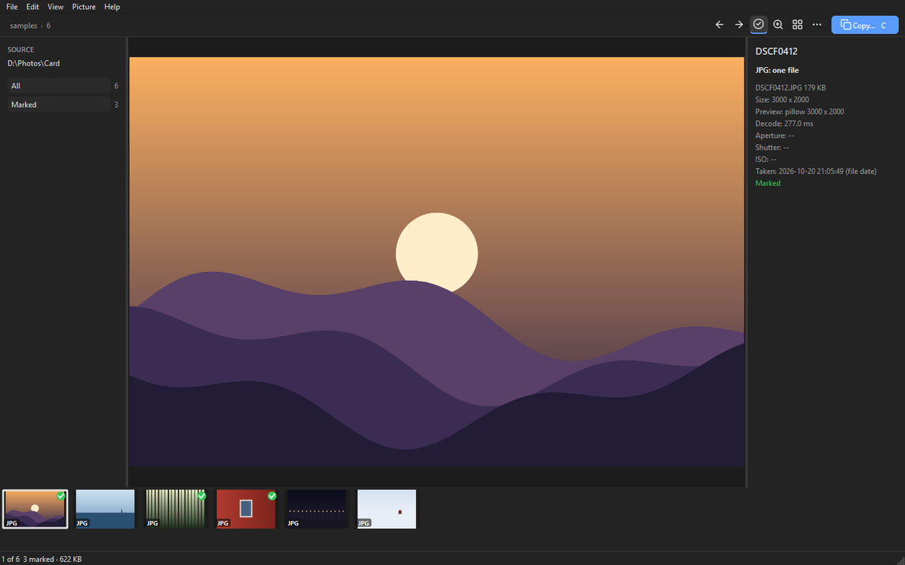
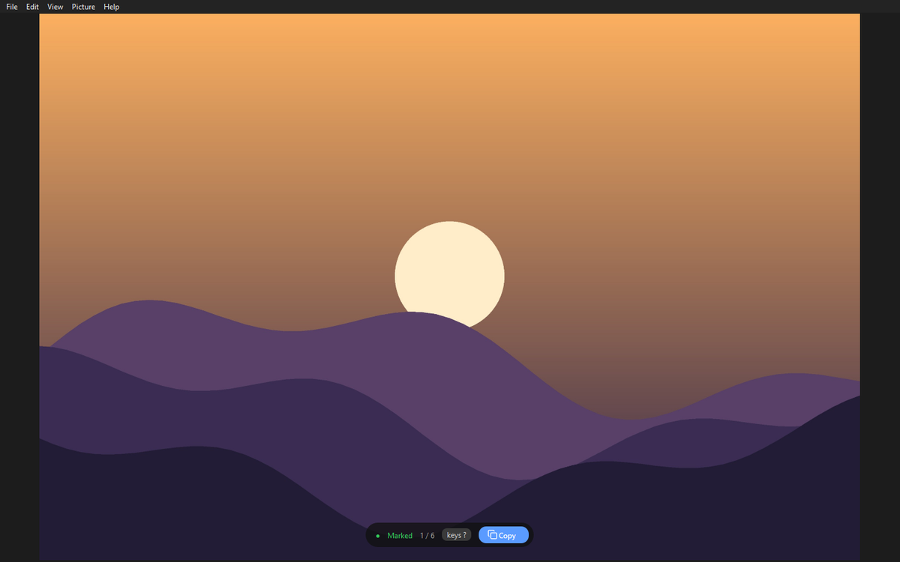
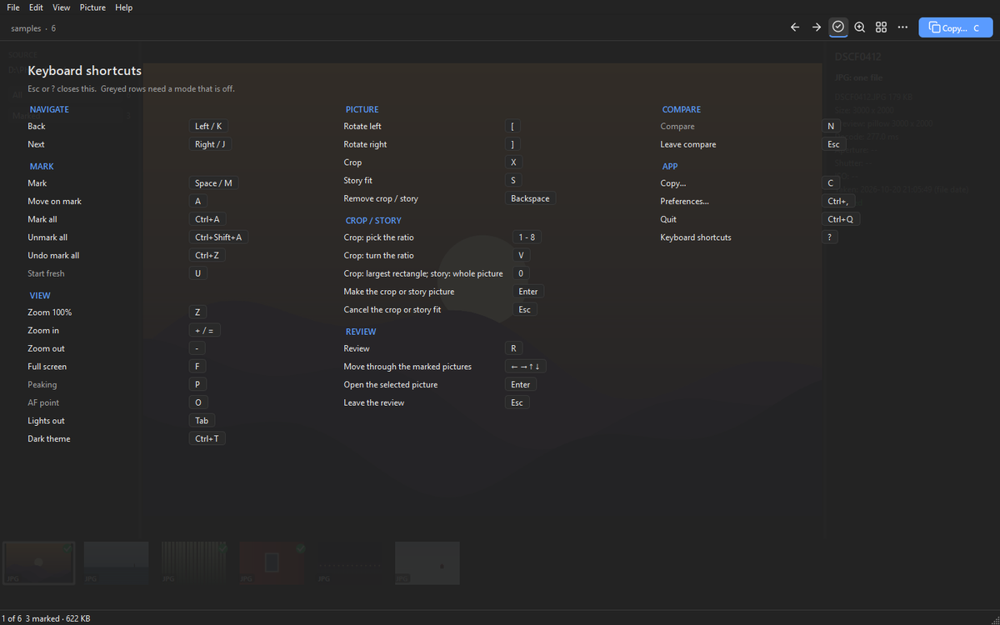
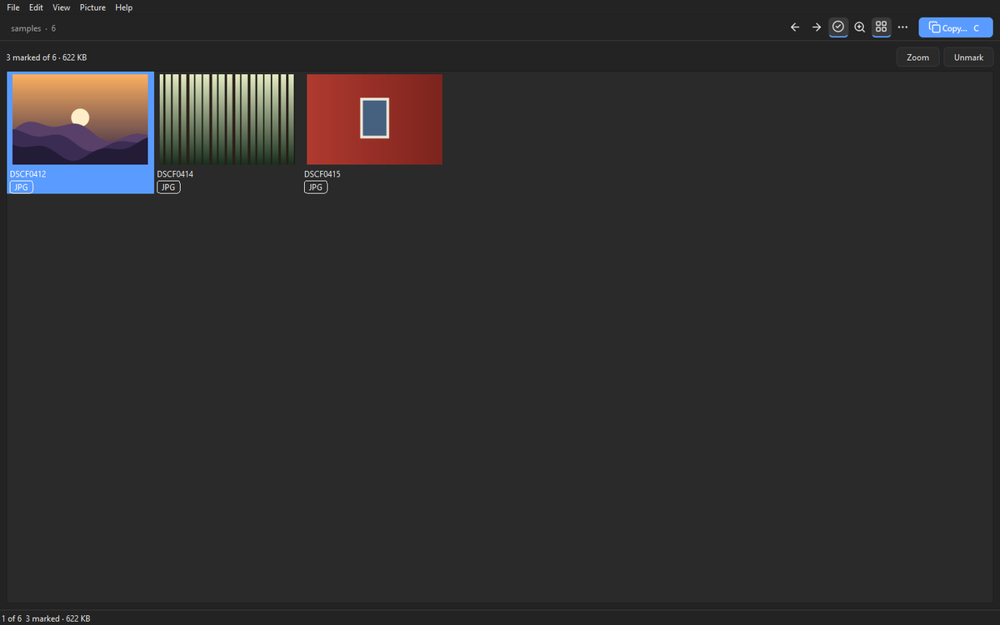
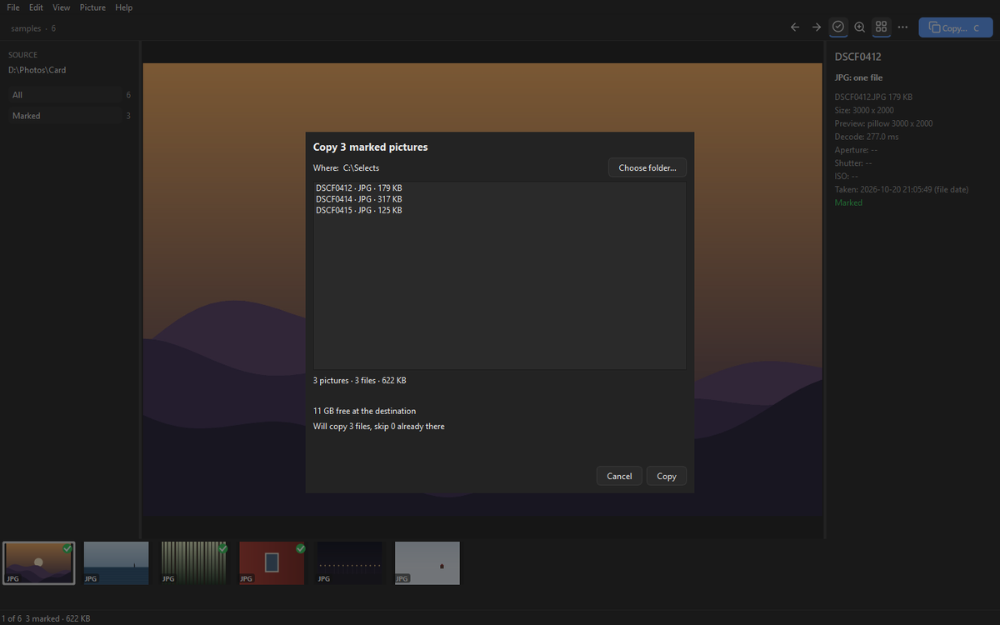
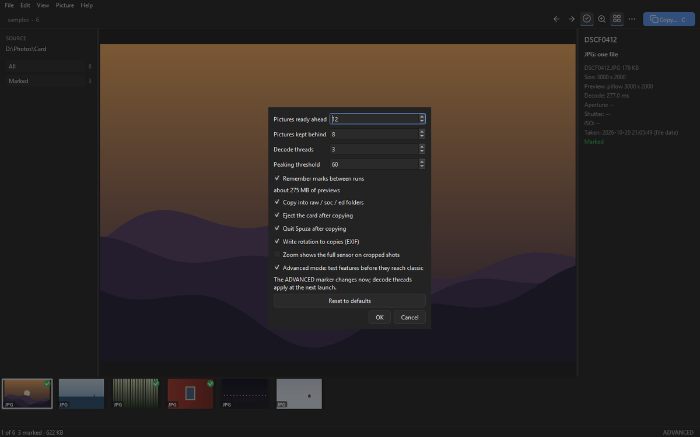
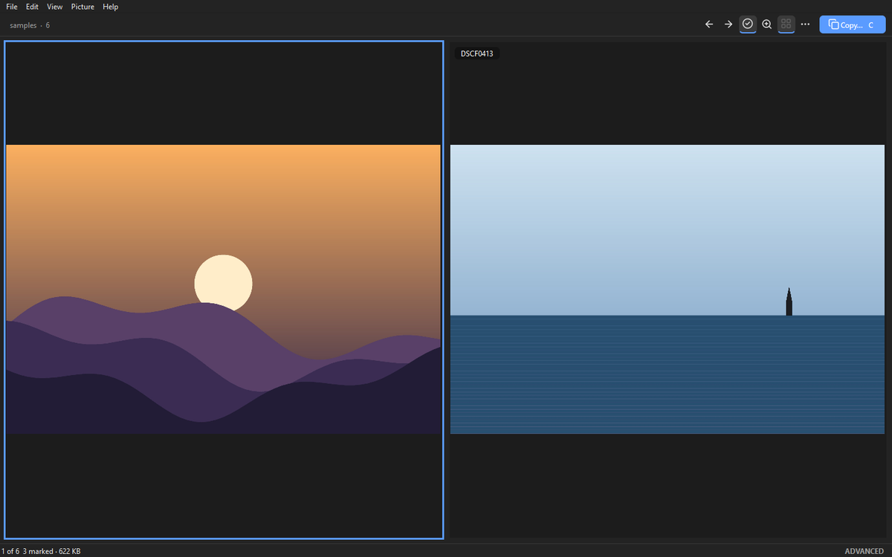
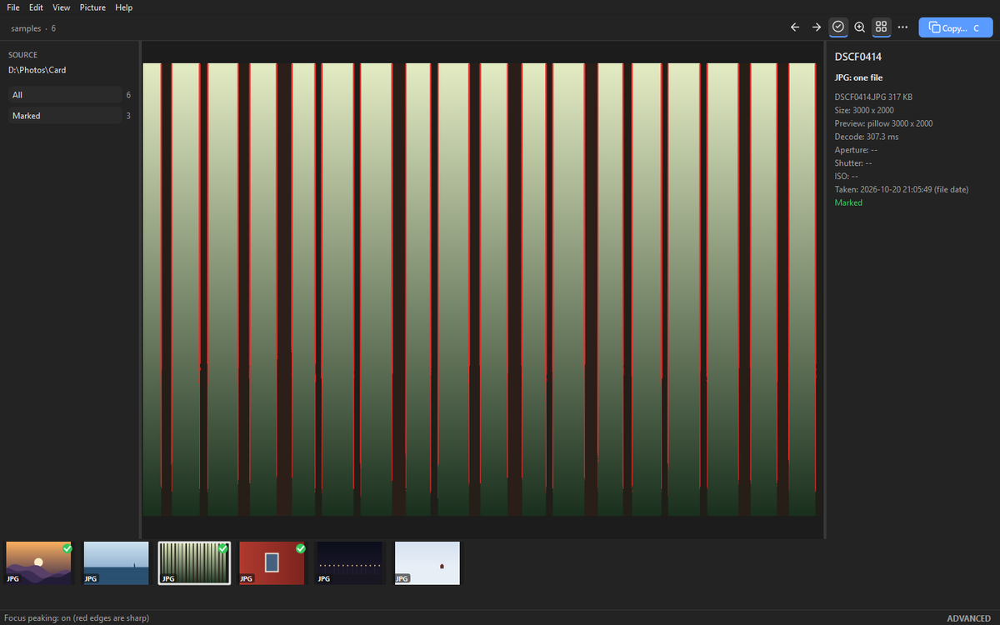

<h1 align="center">Spuza</h1>

<p align="center">
  <b>A fast photo-culling app for camera cards.</b><br>
  Step through a card, mark the keepers, copy them off. One key per decision, and the next pictures are already decoded.
</p>

<p align="center">
  
</p>

<p align="center">
  <a href="https://github.com/fungimasters/Spuza/actions/workflows/ci.yml"></a>
  <a href="https://github.com/fungimasters/Spuza/releases/latest"></a>
  
</p>

**Mac** (Apple Silicon), in Terminal:

```sh
curl -LsSf https://astral.sh/uv/install.sh | sh
```
then, in a new Terminal window:
```sh
uv tool install --python 3.13 git+https://github.com/fungimasters/Spuza
```

**Windows**, in PowerShell:

```powershell
powershell -ExecutionPolicy ByPass -c "irm https://astral.sh/uv/install.ps1 | iex"
```
then, in a new PowerShell window:
```powershell
uv tool install --python 3.13 git+https://github.com/fungimasters/Spuza
```

Then run `spuza` with a card in.
Update with `uv tool upgrade spuza`. There is also a [Mac app](#mac-app) on the release page.

## In this README

[What's new](#whats-new) · [The flow](#the-flow) · [Keys](#keys) · [Review](#review) · [Crop and story fit](#crop-and-story-fit) · [Copying](#copying) · [Preferences](#preferences) · [Classic and advanced](#classic-and-advanced-mode) · [Formats](#formats) · [Speed](#speed) · [Mac app](#mac-app) · [Command line](#command-line) · [Development](#development)

## What's new

- **0.11.0**: Eighth round: a quieter, darker Spuza. Spuza is dark by default on Windows and Linux; on a Mac it follows the system's light or dark appearance until you pick one. `Ctrl+T` (or View, Dark theme) flips it, and the pick is remembered. The bar above the picture is quieter: icon buttons for Back, Next, Mark, Zoom and Review, a filled Copy button, and a `⋯` menu holding Move on mark, Full screen, Preferences, Lights out and the advanced tools. Hover a button for its name and key. `Tab` is Lights out: the bar, sidebar, inspector, filmstrip and status line hide, and a small pill floats over the picture with the mark, `n / N`, `keys ?` and Copy. It is remembered between runs, and `F` full screen stays independent of it. There is now a menu bar (File, Edit, View, Picture, Help) that lists every action with its key, `?` opens a keyboard shortcut overlay, and `Ctrl+Q` quits. The keys and features are otherwise the same.
- **0.10.0**: Seventh feedback round. A crop or a story fit is now a picture of its own on the filmstrip. `Enter` in a crop (`X`) or a story fit (`S`) adds a new picture right after the original, with its own thumbnail and a tag (the ratio, `crop` for Free, an outlined `9:16` for a story). The original is not touched, so `X` on it again cuts another crop: one original, any number of crops and story fits. A crop picture can be viewed, zoomed, marked and stepped through like any other, and `Backspace` removes it. Mark all counts them. Copy writes each marked one to `ed`. A session from 0.9.0 turns its crops and story fits into these pictures.

- **0.9.0**: Sixth feedback round. Crop (`X`) has a ratio strip above the picture. `1` to `8` pick Free, Original, 1:1, 4:5, 3:4, 2:3, 9:16 or 1.91:1, `V` turns the ratio (4:5 becomes 5:4) and `0` resets the rectangle. A locked ratio has four corner handles and a label with the ratio and pixels. The copy names the file after the ratio, `<name>_4x5.jpg`. A picture can now have a crop and a story fit together. The inspector shows the crop in pixels, and the filmstrip tag shows the ratio.
- **0.8.1**: Copying from a read-only card leaves ordinary files you can delete, with the card's dates, and no hidden `.spuza-part` file beside them.
- **0.8.0**: Fifth feedback round. `+` and `-` zoom in 25% steps of the picture's own pixels, from the fitted view up to 400%. The inspector has a `Taken:` line with the date and time the camera wrote, or the file date, marked `(file date)`. Crop (`X`): drag a rectangle on the picture, and the copy gets the result in `ed` as `<name>.jpg` beside the untouched original. Story fit (`S`): place the picture under a fixed 9:16 frame with the wheel and the mouse, and the copy gets a 1080 x 1920 `<name>_story.jpg` in `ed`.
- **0.7.0**: Fourth feedback round. The inspector shows the picture's own size (the JPG beside a raw, else the camera's frame) on one line and the preview's source and size on another. On a raw with a JPG beside it, Z shows the JPG's pixels at 100% in about a quarter of a second instead of decoding the raw. The control bar is one row again: Mark all, Unmark all, undo and the two turns are keys only.
- **0.6.0**: Third feedback round. The filmstrip loads thumbnails wherever you scroll. Z shows the picture's own pixels, one per screen pixel, framed as the camera cropped it; a Preferences row shows the full sensor on cropped shots instead. `[` and `]` rotate a picture in quarter turns; the turn is written as EXIF orientation into the copy only, never into the original. Mark all / Unmark all, with one Ctrl+Z undo.
- **0.5.1**: Spuza has an icon: a slide on a light table. It shows in the Dock, the Mac app, the Windows exe and taskbar, and the window itself.
- **0.5.0**: Second feedback round. With Move on mark on, unmarking moves on too. Full-bleed shows only the picture; the strip appears for a second when the mouse moves. Copying sorts into `raw`, `soc` and an empty `ed` folder, then ejects the card and quits, each an option in Preferences, all on by default. The copy log lives in Spuza's app-data folder, never in the destination.
- **0.4.1**: Nothing is left behind on copy: a HIF, XMP, THM or Live Photo MOV travels with its picture, and files that are not pictures are counted. Bursts are listed in the order the camera shot them. HIF, ARW, NEF, NRW, PEF, 3FR, CR2, ORF, RW2 and CR3 open. With two cards in, Spuza says so and `--card` picks one. Releases now include a Windows build.
- **0.4.0**: four features in advanced mode: Compare (`N`), Focus peaking (`P`), AF point (`O`), and Resume, with Start fresh (`U`).
- **0.3.3**: classic and advanced mode. Advanced mode is a switch in Preferences, and its first setting is the number of decode threads.
- **0.3.2**: 12 pictures are now decoded ahead and 8 kept behind (it was 8 and 3). A Preferences sheet sets those numbers, and `--ahead` and `--behind` set them for one run.
- **0.3.1**: the inspector shows aperture, shutter, ISO, focal length and camera. Right-click a picture to show it in Finder or Explorer. The status strip loses the clock and the "next N ready" label, and the filmstrip loses its green bars. Fixes a rare crash caused by cleanup running on the wrong thread.
- **0.3.0**: 15 fixes:
  - 16-bit greyscale files are no longer clipped.
  - `Z` gives a true 100% view on Retina screens, and the filmstrip is sharp there.
  - Several copy sheet fixes.
  - Copies go to `~/Pictures/Spuza` by default, never to the card.
- **0.2.0**: move on mark (`A`). Marking a picture shows the next one.
- **0.1.3**: a wheel and an unsigned Mac app on every release, and `spuza --version` prints the right version.

## The flow

Spuza is built for the first pass over a shoot: hundreds of frames and a handful of keepers.

1. **Open a card.** Run `spuza`. It looks for a card with a `DCIM` folder (`/Volumes` on a Mac, every drive except the system drive on Windows). To open a folder instead, give its path: `spuza ~/Pictures/trip`.
2. **Step.** `→` and `←` move through the card. Pictures are in the order the camera took them: by capture time, then by the camera's shot counter on Ricoh, Fujifilm and Nikon bodies, then by name; files without capture data follow, by file date.
3. **Mark.** `Space` marks a keeper. The filmstrip and the status line show the count.
4. **Review.** `R` puts every marked picture on one contact sheet for a second look.
5. **Copy.** `C` copies the marked pictures to a folder, sorted into `raw`, `soc` and `ed`. Then Spuza can eject the card and quit.

With two cards in (a camera with two slots, say), Spuza lists both and opens the first. The status line names the other and how many of its pictures are copies of this card's. `spuza --card 2` opens the second.

<p align="center">
  
</p>

The inspector on the right shows:

- the file names and sizes;
- a `Taken:` line, the date and time the camera wrote (for a file without one, the file date, marked `(file date)`);
- the picture's own size (for a raw, that of the JPG beside it, else the camera's frame);
- the preview's source, size and decode time;
- aperture, shutter, ISO, focal length and camera;
- on a crop picture, `Crop of <file>`, the ratio (`Free` for none) and the size in pixels; on a story picture, `Story fit of <file>`, `9:16` and `1080 x 1920 px`.

Right-click a picture in the filmstrip, the viewer or the review to show it in Finder or Explorer.

**Marks never touch your files.** Spuza never writes to a picture, its EXIF or the card. It writes only four things: the copies you ask for (and the `raw`, `soc` and `ed` folders they go in), a log of each copy in its own app-data folder (never in your destination), its own preferences, and, with Resume in advanced mode, a small session file in its app-data folder.

<p align="center">
  
</p>

<p align="center">
  
</p>

<p align="center">
  
</p>

## Keys

Every key in one table. The bar above the picture has icon buttons for the common ones (hover a button for its name and key), and the menu bar (File, Edit, View, Picture, Help) lists every action with its key. Mark all, Unmark all, undo and the two turns (`[` `]`) are keys only. `?` shows the same list over the picture.

| Key | Where | Does |
|---|---|---|
| `→` or `J` | viewer, compare | next picture (compare: the frame moves right) |
| `←` or `K` | viewer, compare | previous picture (compare: the frame moves left) |
| `↑` `↓` | review | move through the sheet with `←` `→` |
| `Space` or `M` | viewer, review, compare | mark or unmark the picture (review: unmark the selected one; compare: the one with the frame) |
| `Ctrl+A` | viewer, review | **Mark all** (`Cmd+A` on a Mac). Keys only, and nothing asks first |
| `Ctrl+Shift+A` | viewer, review | **Unmark all** (`Cmd+Shift+A` on a Mac) |
| `Ctrl+Z` | viewer, review | undo the last Mark all or Unmark all (`Cmd+Z` on a Mac): one level |
| `[` or `]` | viewer, review, compare | rotate left or right by a quarter turn (review: every selected picture; compare: the framed one) |
| `A` | viewer | move on mark, on or off: marking a picture then shows the next one (remembered between runs) |
| `Z` | viewer, review, compare | 100% zoom. A raw with a JPG beside it shows the JPG's own pixels; a raw alone is decoded in full in the background. Compare zooms the framed picture and its neighbour together. On a crop picture it shows that picture's own pixels; on a story picture it zooms the 9:16 view and does not load the original's pixels. Does nothing while you crop or fit a story |
| `+` or `=` | viewer, review, story | zoom in by 25% of the picture's own pixels, up to 400%; from the fitted view the first step is the one above the fit. The keypad `+` works too. In story fit it scales the picture under the frame. Does nothing while you crop |
| `-` | viewer, review, story | zoom out by 25%; the last step back is the fitted view. In story fit it scales the picture down |
| `F` | viewer | full screen, picture only |
| `R` | viewer | review the marked pictures |
| `C` | viewer | copy the marked pictures to a folder |
| `Cmd-,` or `Ctrl-,` | anywhere | Preferences (`Cmd` on a Mac, `Ctrl` on Windows) |
| `Ctrl+Q` | anywhere | Quit (`Cmd+Q` on a Mac) |
| `Tab` | anywhere | Lights out: hide the bar, sidebar, inspector, filmstrip and status line, and float a small pill (marked, `n / N`, `keys ?`, Copy) over the picture. `Tab` again brings the bar back. Remembered between runs. Also View, Lights out. Inside the Copy or Preferences sheet `Tab` still moves between fields |
| `Ctrl+T` | anywhere | switch between the dark and the light theme (`Cmd+T` on a Mac). Remembered between runs. Also View, Dark theme |
| `?` | anywhere | the keyboard shortcut overlay: every key, grouped by task. `Esc` or `?` closes it. The same list is in the menu bar (File, Edit, View, Picture, Help) |
| `X` | viewer | **crop**: drag a rectangle on the picture, with a ratio strip above it. `Enter` adds the result as a new picture after the original. On a crop picture, `X` re-crops it from the original |
| `1` to `8` | crop | pick the ratio: Free, Original, 1:1, 4:5, 3:4, 2:3, 9:16, 1.91:1. Clicking a chip on the strip does the same. Nothing outside the crop |
| `V` | crop | turn the ratio: 4:5 becomes 5:4, 1.91:1 becomes 1:1.91. Free and 1:1 do not change. Nothing outside the crop |
| `S` | viewer | **story fit** 9:16: drag and zoom the picture under a fixed vertical frame. `Enter` adds it as a new picture after the original. On a story picture, `S` re-fits it |
| `0` | crop, story fit | crop: the largest centred rectangle of the ratio. Story fit: back to the whole picture inside the frame |
| `Enter` | crop, story fit, review | make the crop or story fit that is open into a picture (or replace the one being redone); in the review, open the selected picture in the workbench |
| `Backspace` | viewer, crop, story fit | on a crop or story picture, remove it (the original stays); on an original it does nothing. While a crop is open it clears the rectangle; while a story fit is open it puts the picture back whole in the frame |
| `Esc` | everywhere | cancel the crop or story fit that is open (nothing is made); else leave full screen, the review or compare |
| `N` | viewer, review (advanced) | **Compare.** Shows this picture and the next side by side; `N` again adds the next one, up to four |
| `P` | viewer (advanced) | **Focus peaking.** Paints the sharp edges red. Remembered between runs |
| `O` | viewer (advanced) | **AF point.** Draws a ring where the camera focused; `Z` then opens the 100% view on that spot |
| `U` | viewer (advanced) | **Start fresh.** Clears this card's marks, crop pictures' marks included (the crop pictures stay), and its saved session. `U` again within 10 seconds undoes it |

Notes on the keys:

- With Move on mark (`A`) on, unmarking also moves on to the next picture.
- Mark all and Unmark all say how many pictures changed in the status line and never ask first. `Ctrl+Z` puts back exactly the marks you had before. If you marked by hand in between, those changes are replaced and the status line says how many. Only the last Mark all or Unmark all can be undone, until the next one, `U` or closing Spuza.
- A turn (`[` `]`) shows on the screen, the filmstrip and the review. The original is never changed (see [Copying](#copying)).
- In full screen, move the mouse to see the strip for a second.
- Moving to another picture (`→` `←` `J` `K`) while you crop or fit a story cancels the edit.

## Review

`R` shows every marked picture on one contact sheet.

<p align="center">
  
</p>

`↑` `↓` `←` `→` move, `Space` unmarks the selected picture, `Z` opens it at 100% (`Esc` returns to the sheet), `+` and `-` zoom that view, `Enter` opens it in the workbench and `Esc` goes back to the card. Unmarking takes a picture off the list. Spuza never deletes anything.

## Crop and story fit

Two ways to make a ready-to-post picture. Each makes a new picture on the filmstrip, right after the original. The original is never touched, and nothing is written to disk until you copy.

- **Crop (`X`).** Drag a rectangle on the fitted picture (a zoomed picture goes back to fit first). A ratio strip shows above the picture while the crop is open. `Enter` makes the crop picture, `Esc` cancels, `Backspace` clears the rectangle.
- **Story fit (`S`).** A fixed 9:16 frame sits over the picture. Drag to move the picture, zoom with the mouse wheel or `+` `-`, `0` shows the whole picture inside the frame. `Enter` makes the story picture, `Esc` cancels. The copy gets a 1080 x 1920 picture as `ed/<name>_story.jpg`.

The new picture has its own thumbnail and a tag: the ratio (`4:5`, `Original` for Original, `crop` for Free), or an outlined `9:16` for a story fit. The selection moves onto it. Press `X` or `S` on the original again for another one: one original, any number of crops and story fits.

**A crop picture is a picture.** View it fitted; `+` `-` and `Z` work on its own pixels (on a story picture they zoom the 9:16 view, and `Z` does not go to the original's pixels). `Space` marks or unmarks it; a new one starts marked. `→` `←` `J` `K` step through it. Right-click shows the original in Finder or Explorer.

- **Redo.** `X` on a crop picture opens the crop on the original with its rectangle and ratio selected; `Enter` replaces that picture in place. `S` on a story picture does the same for a story fit.
- **Remove.** `Backspace` on a crop or story picture takes it off the filmstrip. On an original it does nothing and says "Nothing to remove here".
- Mark all and Unmark all include these pictures, and the sidebar counts them. The review and compare show originals only.

**The ratio strip.** Press `1` to `8`, or click a chip, to pick Free, Original, 1:1, 4:5, 3:4, 2:3, 9:16 or 1.91:1. The top-row digits work on a Mac; no keypad is needed. 4:5, 3:4, 2:3 and 9:16 open portrait and 1.91:1 opens landscape, whichever way the picture lies. Free and Original follow the picture. `V` turns the ratio, so 4:5 becomes 5:4. `0` resets the rectangle to the largest centred one of the ratio.

- Changing the ratio keeps the rectangle's centre and size, as far as the picture allows. A rectangle you have not touched stays the largest one.
- A locked ratio has four corner handles. Free keeps eight.
- A label inside the rectangle shows the ratio and the size in pixels.
- The digits and `V` do nothing outside the crop.

Rules:

- Neither works in the review or in compare.
- The copy names a ratio crop after the ratio, as the picture is turned in the copy: `<name>_4x5.jpg`, `_1x1`, `_3x4`, `_2x3`, `_9x16`, `_191x100`, and turned `_5x4`, `_4x3`, `_3x2`, `_16x9`, `_100x191`. A Free or Original crop is `<name>.jpg`. Two crops that would get the same name get `-1`, `-2`.
- Only marked pictures are exported. The pixels come from the best source: a JPG beside the raw, else the full decode when the embedded preview is too small, else the preview.
- Your quarter turns are baked into the `ed` files.
- With Resume in advanced mode, these pictures (with their ratio) are saved in the session file beside the marks and turns. A session saved by 0.9.0 comes back as crop and story pictures, marked if their original was.

## Copying

`C` opens the copy sheet. It starts at `~/Pictures/Spuza`, and you can pick any other folder.
The sheet shows the plan before anything is copied: how many files, how many bytes (crop and story sizes are estimates), and what is already in that folder.

<p align="center">
  
</p>

**What lands where.** With **Copy into raw / soc / ed folders** on (the default):

| Folder | Holds |
|---|---|
| `raw` | raw files. A picture's XMP or MOV goes with its raw |
| `soc` | JPEGs and other picture formats (HIF, HEIF, PNG...). A raw+JPEG pair is split between `raw` and `soc` |
| `ed` | empty unless you marked a crop or story picture: `<name>.jpg` for a Free or Original crop, `<name>_4x5.jpg` (and the other ratio names) for a ratio crop, `<name>_story.jpg` (1080 x 1920) for a story fit |

- **Originals are always untouched** in `raw` and `soc`: byte-for-byte copies.
- **A marked crop or story picture is written to `ed`**, whether or not its original is marked. A copy with only crop pictures marked is allowed.
- **Quarter turns** (`[` `]`) are written into the copies in `raw` and `soc` as EXIF orientation only (the **Write rotation to copies (EXIF)** preference, on by default). They are baked into the `ed` files.
- With the folders option off, the originals go flat into the destination; marked crop and story pictures still go into `ed`.

Other rules:

- A raw file and a JPEG with the same name (`DSCF0412.RAF` and `DSCF0412.JPG`) are one picture: one mark, copied together. So is a `HIF` beside a raw, and any other file with the picture's name (an `XMP`, a `THM`, a Live Photo's `MOV`).
- A file already in the folder with identical content is skipped.
- A different file with the same name makes the copy get a suffix (`DSCF0412-1.JPG`). Nothing in the destination is ever overwritten. A repeated copy of a crop or story writes a new suffixed file.
- After a successful copy, **Eject the card after copying** and **Quit Spuza after copying** (both on by default) eject the card you opened and then close Spuza, after a 3 second countdown with a **Stay** button. A failed eject is reported and does not stop the quit. If anything failed or you cancelled, nothing is ejected and Spuza stays open.
- Each copy writes a log, `spuza-copy-<date>-<time>.log`, with every file copied, skipped or renamed, and the totals. It is kept in Spuza's app-data folder (`logs`), never in the destination.

## Preferences

`Cmd-,` (`Ctrl-,` on Windows) or Preferences in the `⋯` menu opens it:

- **Pictures ready ahead** (1-64, default 12) and **Pictures kept behind** (0-64, default 8). The memory those previews take is shown under the rows.
- **Copy into raw / soc / ed folders**, **Eject the card after copying**, **Quit Spuza after copying** and **Write rotation to copies (EXIF)** (all default on): see [Copying](#copying).
- **Zoom shows the full sensor on cropped shots** (default off). Some cameras can crop a shot as they take it. With the row off, `Z` on such a shot shows the camera's own frame at 100%. With it on, `Z` shows the whole sensor at 100% instead, and the label says `100% · full sensor`. The fitted view, the review sheet and compare always show the camera's frame; uncropped shots and JPEGs are the same either way.
- **Advanced mode**: see below.
- Advanced mode only:
  - **Decode threads** (1-8, default 3, applied at the next launch).
  - **Peaking threshold** (1-255, default 60).
  - **Remember marks between runs** (default on).
- **Reset to defaults**.

<p align="center">
  
</p>

## Classic and advanced mode

Spuza opens in classic mode, which has every feature that has shipped. Advanced mode adds the features that are still being tried out. They are marked "advanced" in the [key table](#keys).

- To switch for good, tick "Advanced mode" in Preferences. The setting is saved, and the mode changes at once; decode threads follow at the next launch.
- To switch for one run, use `spuza --advanced` or `spuza --classic`. The saved preference is not touched.

In advanced mode the window title reads `Spuza (advanced)` and the status strip shows an `ADVANCED` tag.
A feature that proves itself moves to classic. How flags are added and promoted is in [docs/FEATURE_FLAGS.md](docs/FEATURE_FLAGS.md).

The advanced features, by flag:

- `compare_view` (`N`): **Compare.**
- `focus_peaking` (`P`): **Focus peaking.**
- `focus_point` (`O`): **AF point.**
- `resume_session` (`U`): **Resume** and Start fresh.
- `decode_threads`: **Decode threads.**

<p align="center">
  
</p>

**Compare** in detail:
- `←` and `→` (or `J` and `K`) move the frame between the pictures, and `Space` marks the one with the frame.
- `Z` zooms the framed picture and its neighbour to 100% together, and dragging pans both.
- `Esc` returns to the picture that had the frame.
- From the review, `Ctrl`-click (`Cmd`-click on a Mac) two to four marked pictures, then press `N`.

<p align="center">
  
</p>

**AF point** works with Fujifilm RAF files from the X-T4, X-T5, X100V and X-T50. Other files have no ring.

**Resume** puts back each card's marks and your place the next time you open the same card, and a banner says what it restored. The session file is in Spuza's app-data folder, never on the card. Sessions older than 30 days are deleted at start. To turn Resume off, untick "Remember marks between runs".

**Decode threads** sets how many pictures are decoded at once, from 1 to 8. Classic always uses 3.

## Formats

| Family | Files | Shown as |
|---|---|---|
| Raw | Fujifilm `RAF`, `DNG` (cameras and phones), Sony `ARW`, Nikon `NEF`, `NRW`, Pentax `PEF`, Hasselblad `3FR`, Canon `CR2` | the full-size JPEG preview embedded in the raw file |
| Raw, via LibRaw's thumbnail | Olympus/OM `ORF`, Panasonic `RW2`, Canon `CR3` | the preview LibRaw extracts (on some Panasonic bodies a 1920 px one) |
| JPEG | `JPG`, `JPEG` | as is |
| HEIF | `HIF` (Fujifilm, Canon), `HEIC`, `HEIF` | as is; a `HIF` beside a raw of the same name is one picture with it, like a JPEG |
| Other | `PNG`, `GIF`, `BMP`, `TIF`, `TIFF` | as is |

Any other file with the same name as a picture (an `XMP`, a `THM`, the `MOV` of a Live Photo) is copied with that picture. Files that are not pictures and belong to none are not copied; the copy sheet counts them and lists them in its tooltip, and it counts files it could not read. Hidden files, system folders and symlinks are skipped without a note.

## Speed

- **Raw files are not demosaiced while you step.** Each raw file carries a JPEG preview made by the camera. Spuza reads it straight out of the file and shows that. The full decode runs only when you press `Z`, and only if the preview is smaller than the sensor.
- **Prefetch.** The pictures ahead of and behind the current one are decoded on worker threads, so a step only swaps in an image that is already decoded.

Measured on Windows with 0.4.0, using `spuza --demo <folder> --bench`. The test card held five Ricoh GR III DNGs (28.5-28.9 MB each) and one Fujifilm X-Pro2 RAF (23 MB):

| | Measured |
|---|---|
| First picture on screen | 839-1125 ms over two runs |
| Step, mean | 5.7 ms |
| `Z` full decode of the X-Pro2 RAF (0.3.1) | 3.4-3.5 s, in the background |
| Memory after 300 steps, default window of 12 ahead and 8 behind (0.3.2, a different card: 1000 JPEGs of 3000x2000) | 229-259 MB |

These numbers have not been measured on a Mac yet. To set the prefetch window for one run, use `--ahead N --behind N`.

## Mac app

Every [release](https://github.com/fungimasters/Spuza/releases/latest) also has `Spuza-macos.zip`. It holds a self-contained `Spuza.app` that CI builds on a macOS runner. Unzip it and drag `Spuza.app` to Applications.

For Windows, the same release has `Spuza-windows.zip`: unzip it and run `Spuza.exe` from the folder (SmartScreen asks once: More info, then Run anyway). `spuza-cli.exe` beside it is the same app with a console, for `--version` and `--bench`.

The app is not code-signed, so macOS blocks the first launch. To allow it:

1. Open **System Settings > Privacy & Security**.
2. Scroll to the message about Spuza and click **Open Anyway**.

You only need to do this once. The Terminal alternative is:

```sh
xattr -dr com.apple.quarantine /Applications/Spuza.app
```

## Command line

| | |
|---|---|
| `spuza` | open the first camera card found |
| `spuza <folder>` | open a folder |
| `--advanced`, `--classic` | the mode for this run only |
| `--ahead N`, `--behind N` | the prefetch window for this run only |
| `--card N`, `--card <path>` | with two or more cards mounted, open this one (Spuza lists them and opens the first by default) |
| `--demo <folder> --bench` | open a folder, step through it scripted, print timings, exit |
| `--version` | print the version |
| `uv tool upgrade spuza` | update |
| `uv tool uninstall spuza` | remove |

Why uv and not an installer? Spuza is a Python application. `uv tool install` gives it its own Python and its own dependencies, and it puts one `spuza` command on your PATH. Updating or removing it is clean, it never touches the system Python, and it needs no admin rights.

## Development

```sh
git clone https://github.com/fungimasters/Spuza
cd Spuza
uv sync
uv run spuza --demo docs/samples
```

To run the gate from the repository root:

```sh
uv run --project . ruff check --select F src tests && uv run --project . python -m pytest -q
```

- **CI** runs the gate on Linux, Windows and macOS 15, and it builds the unsigned `Spuza.app` and a Windows build, `Spuza-windows.zip`.
- **Releases.** Pushing a tag `vX.Y.Z` publishes a GitHub release. The steps are in [RELEASING.md](RELEASING.md).
- **README check.** `docs/check_readme.py` runs as part of the test suite. It fails if this README misses a key, flag, command-line option, file format or the current version.
- **Images.** `uv run python docs/shots.py` makes every image in this README. It drives the real window over `docs/samples`.

Spuza is built with [PySide6](https://doc.qt.io/qtforpython-6/), [rawpy](https://github.com/letmaik/rawpy), [Pillow](https://python-pillow.org/) and [pillow-heif](https://github.com/bigcat88/pillow_heif). It needs Python 3.12 or newer; CI tests 3.13.

## License

[MIT](LICENSE)
